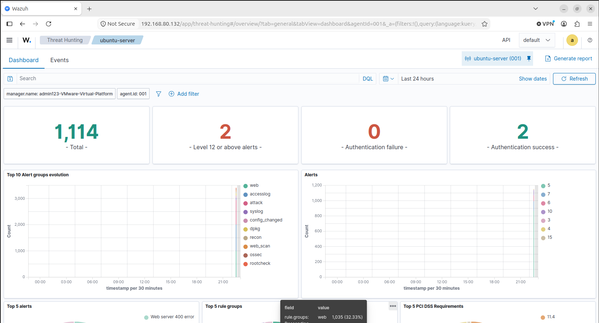
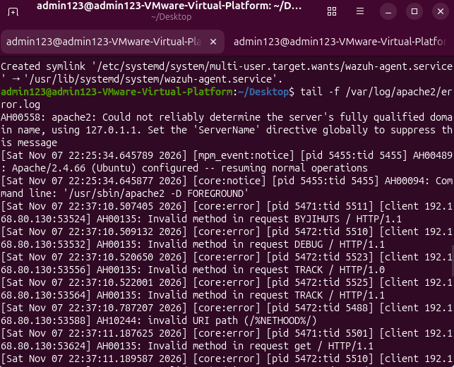
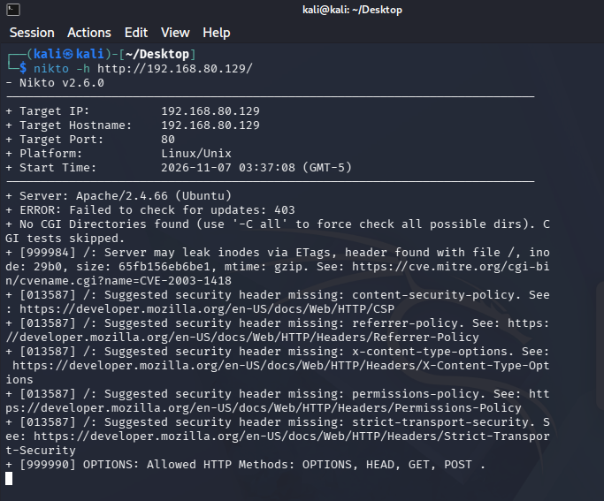
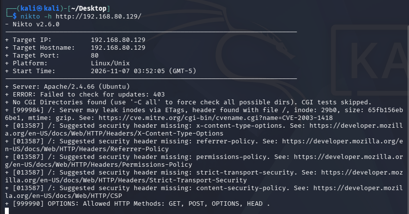
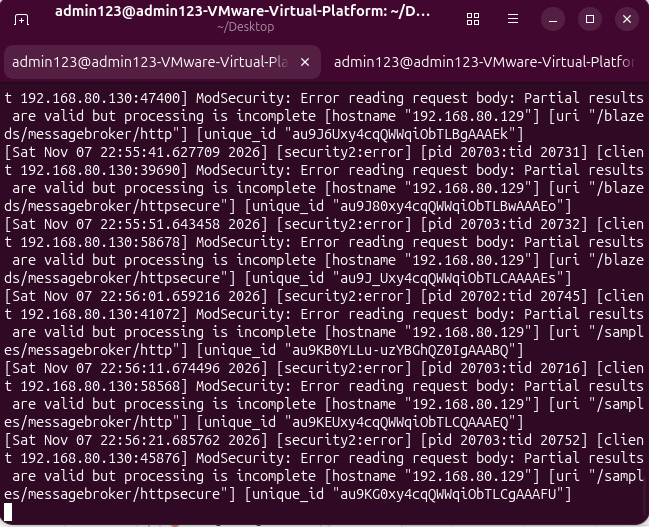
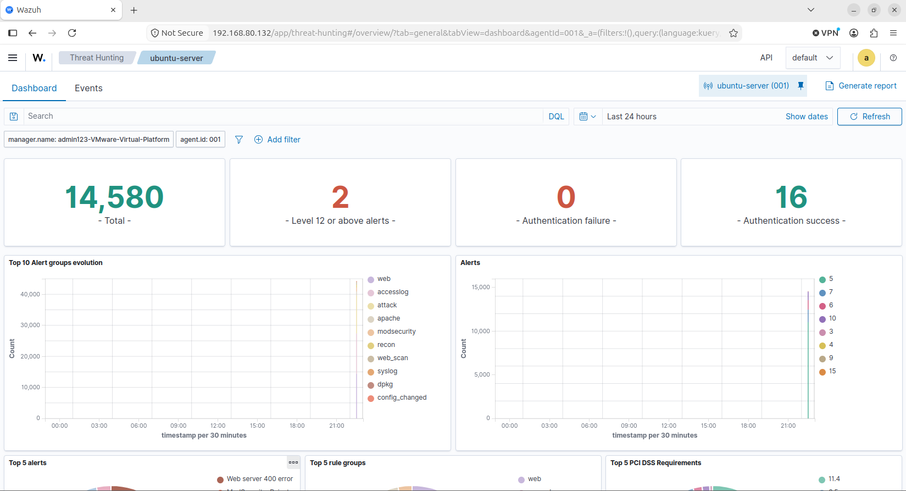
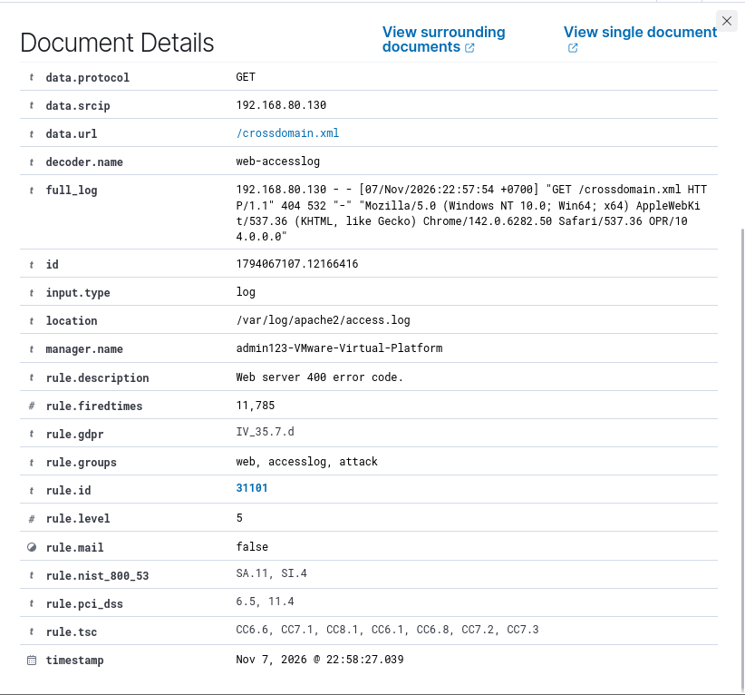

# WAF Lab with SIEM — Nikto Web Scan Detection using ModSecurity + Wazuh

## 📖 บทนำ

Lab นี้สาธิตให้เห็นว่า **SIEM เพียงอย่างเดียวไม่สามารถตรวจจับพฤติกรรมการโจมตีในระดับ Application Layer** (เช่น SQL Injection, XSS, Web Vulnerability Scanning) ได้อย่างมีประสิทธิภาพ เพราะก่อนติดตั้ง WAF นั้น Wazuh จะเห็นเพียงข้อมูลทราฟฟิกพื้นฐาน (เช่น HTTP Status Code ทั่วไป) แต่ไม่เห็น Payload หรือพฤติกรรมการตรวจสอบช่องโหว่เชิงลึก

เมื่อติดตั้ง **ModSecurity (Web Application Firewall - WAF)** เข้ามาเสริมที่ Apache Web Server และส่ง Log ไปยัง Wazuh Manager ผ่าน Wazuh Agent ระบบจึงสามารถตรวจจับ วิเคราะห์พฤติกรรม และแจ้งเตือนการโจมตีระดับเว็บแอปพลิเคชันได้อย่างแม่นยำ

ใน Lab นี้ เราจำลองการสแกนช่องโหว่ด้วย **Nikto** ทั้ง 2 รอบ (ก่อนและหลังติดตั้ง ModSecurity) และแสดงให้เห็นว่าจำนวน Event และ Alert บน Wazuh Dashboard **เพิ่มขึ้นอย่างก้าวกระโดดจาก 1,114 สู่ 14,580 เหตุการณ์** อย่างชัดเจน

---

## 🏗️ สถาปัตยกรรมระบบ (Architecture)

```mermaid
graph LR
    K["Kali Linux<br/>(192.168.80.130)<br/>Attacker (Nikto v2.6.0)"] -->|1. Web Attack / Nikto Scan<br/>HTTP Port 80| W["Ubuntu Web Server<br/>(192.168.80.129)<br/>Apache 2.4.66 + ModSecurity<br/>Wazuh Agent: ubuntu-server"]
    W -->|2. Log Forwarding<br/>Port 1514 (TCP)| S["Ubuntu SIEM Server<br/>(192.168.80.132)<br/>Wazuh Manager + Indexer + Dashboard<br/>admin123-VMware-Virtual-Platform"]
```

---

## 🖥️ สภาพแวดล้อมแล็บจริง (Lab Environment)

| Component | บทบาท / ระบบปฏิบัติการ | IP Address | ข้อมูลคอนฟิกูเรชัน / เครื่องมือ |
|---|---|---|---|
| **Attacker** | Kali Linux | `192.168.80.130` | เครื่องมือสแกน: `nikto` v2.6.0 |
| **Target (Web Server)** | Ubuntu Server 22.04 LTS | `192.168.80.129` | Apache/2.4.66, ModSecurity v2 (`SecRuleEngine On`), Wazuh Agent (`ubuntu-server`, ID: `001`) |
| **SIEM Server** | Ubuntu Server 22.04 LTS | `192.168.80.132` | Wazuh All-in-One v4.14 (Hostname: `admin123-VMware-Virtual-Platform`) |
| **Hypervisor** | VMware Workstation | Host-Only / NAT Network | เชื่อมต่อระบบเครือข่ายภายในแล็บ |

> 📌 **หมายเหตุเรื่องชื่อ Agent:** ในคู่มือเบื้องต้นระบุชื่อ `ubuntu-web` แต่ในการทดสอบแล็บจริง Agent ลงทะเบียนไว้ในชื่อ **`ubuntu-server` (ID `001`)** ซึ่งเอกสารนี้ยึดตามหลักฐานจริงในรูปภาพผลการทดสอบ

---

## 🚀 โครงสร้างโฟลเดอร์ (Directory Structure)

```text
03-nikto-web-scan-detection/
├── README.md                                  # เอกสารสรุปแล็บและผลการทดลอง (ไฟล์นี้)
├── images/                                    # ภาพหลักฐานจากการทดสอบจริง
│   ├── 01-nikto-round1.png                    # ผลการสแกน Nikto รอบที่ 1
│   ├── 02-nikto-round2.png                    # ผลการสแกน Nikto รอบที่ 2
│   ├── 03-tail-log-before.png                 # Log บน Web Server ก่อนติดตั้ง ModSecurity
│   ├── 04-tail-log-modsecurity.png            # Log บน Web Server หลังเปิดใช้งาน ModSecurity
│   ├── 05-threat-hunting-before.png           # Dashboard ก่อนติดตั้ง ModSecurity (1,114 events)
│   ├── 06-threat-hunting-after.png            # Dashboard หลังติดตั้ง ModSecurity (14,580 events)
│   └── 07-event-detail.png                    # รายละเอียด Document Rule 31101 ใน Wazuh
├── queries/
│   └── wazuh_queries.md                       # Lucene/KQL Query สำหรับสืบค้นภัยคุกคาม
└── scripts/
    ├── install_wazuh_siem.sh                  # สคริปต์ติดตั้ง Wazuh All-in-One บนเครื่อง SIEM
    ├── install_wazuh_agent.sh                 # สคริปต์ติดตั้งและเชื่อมต่อ Wazuh Agent บน Web Server
    ├── install_modsecurity.sh                 # สคริปต์ติดตั้ง Apache2 และ ModSecurity WAF
    ├── integrate_modsecurity_logs.sh          # สคริปต์ตั้งค่า Agent ส่ง Apache & ModSecurity Log
    └── attack_nikto.sh                        # สคริปต์ยิง Nikto Scan จาก Kali Linux
```

---

## ⚙️ ขั้นตอนการทดสอบและการทำงาน (Setup and Reproduction)

### ขั้นที่ 1: เตรียมสภาพแวดล้อม SIEM Server
ติดตั้ง Wazuh All-in-One (Manager, Indexer, Dashboard) บนเครื่อง SIEM (`192.168.80.132`):

```bash
sudo bash scripts/install_wazuh_siem.sh
```

เข้าถึง Wazuh Dashboard ได้ที่ `https://192.168.80.132`

---

### ขั้นที่ 2: ติดตั้ง Wazuh Agent บน Web Server
ติดตั้ง Apache2 และติดตั้ง Wazuh Agent เพื่อเชื่อมต่อไปยัง SIEM:

```bash
sudo WAZUH_MANAGER_IP=192.168.80.132 WAZUH_AGENT_NAME=ubuntu-server bash scripts/install_wazuh_agent.sh
```

ตรวจสอบสถานะการทำงานของ Agent:
```bash
sudo systemctl status wazuh-agent
sudo tail -n 20 /var/ossec/logs/ossec.log
```

---

### ขั้นที่ 3: บันทึก Baseline Events ก่อนเริ่มโจมตี
ไปที่ Wazuh Dashboard → **Threat Hunting** → **Dashboard** แล้ว Filter:
```text
agent.name:"ubuntu-server"
```

- **จำนวน Total Alerts ก่อนโจมตี:** `1,114` เหตุการณ์


*ภาพที่ 1: Wazuh Threat Hunting Dashboard แสดง Total Alerts ก่อนเริ่มโจมตีอยู่ที่ 1,114 เหตุการณ์*

---

### ขั้นที่ 4: เปิด Real-time Log มอนิเตอร์บน Web Server
เปิด Terminal บน Web Server แล้วรันคำสั่งติดตาม Error Log ของ Apache ค้างไว้:

```bash
tail -f /var/log/apache2/error.log
```


*ภาพที่ 2: Apache error log บันทึก Method ที่ไม่ถูกต้อง (`BYJIHUTS`, `DEBUG`, `TRACK`, `get`) และ Path ผิดปกติจาก Nikto*

---

### ขั้นที่ 5: ⚔️ โจมตีด้วย Nikto รอบที่ 1 (ก่อนติดตั้ง ModSecurity)
จากเครื่อง Kali Linux (`192.168.80.130`) รันการสแกนช่องโหว่ไปยัง Web Server:

```bash
bash scripts/attack_nikto.sh 192.168.80.129
# หรือคำสั่งตรง:
nikto -h http://192.168.80.129/
```


*ภาพที่ 3: Nikto สแกนพบการตั้งค่า Header ขาดความปลอดภัย (CSP, X-Content-Type-Options) และข้อมูล Server Apache/2.4.66*

> ⚠️ **ข้อสังเกต:** ในรอบแรกนี้ Wazuh ตรวจพบเพียง HTTP Status Client Error ทั่วไป แต่ยังไม่มี Alert กลุ่ม WAF หรือพฤติกรรมการโจมตีเชิงลึก

---

### ขั้นที่ 6: ติดตั้งและเปิดใช้งาน ModSecurity WAF บน Web Server
รันสคริปต์ติดตั้ง ModSecurity และเปลี่ยนโหมดเป็น `SecRuleEngine On`:

```bash
sudo bash scripts/install_modsecurity.sh
```

คำสั่งที่สคริปต์ดำเนินการ:
1. ติดตั้งแพ็กเกจ `libapache2-mod-security2`
2. เปิดใช้งานโมดูล Apache: `sudo a2enmod security2`
3. คัดลอกคอนฟิก `modsecurity.conf-recommended` → `modsecurity.conf`
4. เปลี่ยน `SecRuleEngine DetectionOnly` เป็น `SecRuleEngine On` เพื่อเริ่มตรวจจับและบล็อกภัยคุกคาม
5. ทดสอบและรีสตาร์ท Apache: `sudo systemctl restart apache2`

---

### ขั้นที่ 7: เชื่อมต่อ Log ModSecurity เข้ากับ Wazuh Agent
รันสคริปต์เพื่อตั้งค่า `/var/ossec/etc/ossec.conf` ให้รวบรวม Log ทั้ง `access.log` และ `error.log`:

```bash
sudo bash scripts/integrate_modsecurity_logs.sh
```

สคริปต์จะแทรกการตั้งค่าเข้า `<ossec_config>` และรีสตาร์ท `wazuh-agent`:
```xml
<localfile>
  <log_format>apache</log_format>
  <location>/var/log/apache2/access.log</location>
</localfile>
<localfile>
  <log_format>syslog</log_format>
  <location>/var/log/apache2/error.log</location>
</localfile>
```

---

### ขั้นที่ 8: ⚔️ โจมตีด้วย Nikto รอบที่ 2 (หลังเปิดใช้งาน ModSecurity)
เปิดมอนิเตอร์ `tail -f /var/log/apache2/error.log` ค้างไว้ จากนั้นรัน Nikto อีกครั้งจาก Kali Linux:

```bash
bash scripts/attack_nikto.sh 192.168.80.129
```


*ภาพที่ 4: การสแกน Nikto รอบที่ 2 ต่อ Web Server*

ระหว่างการสแกน หน้าต่างมอนิเตอร์บน Web Server จะแสดง Alert ของ ModSecurity แบบ Real-time:


*ภาพที่ 5: ModSecurity เข้าตรวจสอบ Request และบันทึกข้อผิดพลาด `[security2:error]` เช่น Error reading request body และการบล็อก Request*

---

### ขั้นที่ 9: ตรวจสอบผลลัพธ์บน Wazuh Dashboard
กลับไปที่ Wazuh Dashboard → **Threat Hunting** ฟิลเตอร์ `agent.name:"ubuntu-server"`:


*ภาพที่ 6: Total Alert พุ่งสูงขึ้นเป็น 14,580 เหตุการณ์ พร้อมกับการปรากฏของกลุ่ม Rule `modsecurity` ใน Top 10 Alert groups*

ตรวจสอบ Document Detail ของ Alert เพื่อดูโครงสร้างเหตุการณ์:


*ภาพที่ 7: รายละเอียด Event ใน Wazuh Dashboard แสดง Rule 31101 (Web server 400 error code), Decoder `web-accesslog`, และ IP ผู้โจมตี `192.168.80.130`*

---

## 📊 สรุปผลการเปรียบเทียบ (Experiment Results)

| สถานะการทดสอบ | จำนวน Total Alert บน Wazuh | กลุ่ม Rule สำคัญที่ตรวจพบ | ความสามารถในการตรวจจับ |
|---|:---:|---|---|
| **ก่อนการโจมตี (Baseline)** | **1,114** | `web`, `accesslog`, `syslog`, `dpkg` | สภาวะปกติของระบบ |
| **หลัง Nikto รอบที่ 1 (ยังไม่มี WAF)** | **~1,114** (แทบไม่เปลี่ยนแปลง) | `web`, `accesslog` (Rule 31101) | เห็นเฉพาะ HTTP Status 400/404 ทั่วไป |
| **หลังติดตั้ง ModSecurity + Nikto รอบที่ 2** | **14,580** (+13,466 เหตุการณ์) | `web`, `accesslog`, `attack`, `apache`, `modsecurity` | ตรวจพบ Payload การสแกน, WAF Rule Match ครบถ้วน |

---

## 🔍 บทวิเคราะห์เชิงเทคนิค (Technical Analysis)

### 1. ทำไม SIEM เพียงอย่างเดียวจึงไม่เพียงพอสำหรับ Web Application?
Wazuh Agent ทั่วไปที่อ่านเพียง Apache Web Server Access Log จะมีเฉพาะ:
- Client IP (`192.168.80.130`)
- HTTP Method & URI Path (`GET /crossdomain.xml`)
- HTTP Status Code (`404`, `532`)
- User-Agent

ข้อมูลเหล่านี้ **ไม่สามารถบอกเจตนาที่แท้จริงได้** เมื่อคำขอส่ง Payload โจมตีที่ซับซ้อน เช่น SQL Injection (`' OR 1=1--`) หรือ Path Traversal ที่อาจตอบกลับด้วย HTTP 200 OK ระบบ SIEM จึงมองข้ามไป

### 2. บทบาทสำคัญของ ModSecurity (WAF)
เมื่อติดตั้ง ModSecurity:
1. **Inspection:** WAF ทำการตรวจสอบ Request Body, Headers, Parameters อย่างละเอียดตามกฎ OWASP Core Rule Set
2. **Action:** เมื่อพบ Request ที่ผิดปกติ ModSecurity จะปฏิเสธการเชื่อมต่อ (HTTP 403 Forbidden)
3. **Logging & Ingestion:** ModSecurity บันทึกรายละเอียดการตรวจสอบลงใน Apache Error Log ซึ่ง Wazuh Agent อ่านและส่งต่อไปยัง Wazuh Manager
4. **Correlation:** Wazuh ถอดรหัสผ่าน Rule กลุ่ม `modsecurity` ทำให้เกิด Alert จำนวนมหาศาล (14,580 ครั้ง) ช่วยให้ SOC Analyst ตรวจพบการโจมตีได้ทันที

---

## ✅ สรุปผลการประเมิน (Conclusion)

| ประเด็นการวิเคราะห์ | ก่อนติดตั้ง ModSecurity | หลังติดตั้ง ModSecurity |
|---|---|---|
| **การมองเห็น Web Attack** | ❌ มองไม่เห็นการเจาะระบบเชิงลึก | ✅ เห็นพฤติกรรมการสแกนและ Payload ชัดเจน |
| **จำนวน Total Alerts** | ❌ แทบไม่เปลี่ยน (1,114 เหตุการณ์) | ✅ เพิ่มขึ้นอย่างก้าวกระโดด (14,580 เหตุการณ์) |
| **การสกัดกั้น (Mitigation)** | ❌ ไม่มี (ปล่อยให้ Request ผ่านเข้า Server) | ✅ สกัดกั้นทันทีด้วย HTTP 403 Forbidden |
| **คุณภาพข้อมูลที่ SIEM ได้รับ** | ข้อมูลระดับพื้นฐาน (HTTP Status Code) | ข้อมูลเชิงลึก (Payload, Header, Rule ID) |

> 📌 **บทสรุปสำคัญ:** SIEM เพียงอย่างเดียวไม่เพียงพอสำหรับการปกป้องเว็บแอปพลิเคชันในระดับ Application Layer จำเป็นต้องมี **WAF (ModSecurity)** ที่คอยทำ Deep Packet/Payload Inspection และส่ง Log แบบบูรณาการกลับมายัง SIEM เพื่อการแจ้งเตือนและการตอบสนองต่อภัยคุกคามอย่างทันท่วงที

---

## 🛠️ การแก้ไขปัญหาที่พบบ่อย (Troubleshooting)

### 1. Wazuh Agent ไม่ขึ้นสถานะ Active
```bash
sudo systemctl status wazuh-agent
sudo tail -f /var/ossec/logs/ossec.log
```
- ตรวจสอบ Firewall บนเครื่อง SIEM: ตรวจสอบว่าเปิดพอร์ต `1514/tcp` และ `1515/tcp`
- ทดสอบการเชื่อมต่อจาก Web Server: `nc -zv 192.168.80.132 1514`

### 2. ModSecurity ไม่บันทึก Log ลงใน error.log
```bash
grep SecRuleEngine /etc/modsecurity/modsecurity.conf   # ต้องแสดงเป็น SecRuleEngine On
sudo apache2ctl -M | grep security2                     # ต้องพบ security2_module
sudo tail -n 50 /var/log/apache2/error.log
```

### 3. Wazuh Dashboard ไม่แสดง Alert เพิ่มขึ้นหลังการสแกน
1. ตรวจสอบ Filter บน Dashboard: ต้องระบุเป็น `agent.name:"ubuntu-server"` (ตรงกับ Agent Name จริง)
2. ตรวจสอบ Time Range ด้านบนขวา: แนะนำให้เลือกเป็น `Last 24 hours` หรือ `Last 1 hour`
3. ตรวจสอบไฟล์ `/var/ossec/etc/ossec.conf` บน Web Server ว่ามีบล็อก `<localfile>` ของ `/var/log/apache2/error.log` อยู่ภายในแท็ก `<ossec_config>` และรีสตาร์ท agent แล้วหรือไม่

---

## 🎯 การเทียบเคียง MITRE ATT&CK Framework

| MITRE Technique ID | ชื่อเทคนิค | รายละเอียดที่ตรวจพบในแล็บ | Wazuh Rule ID / Group |
|---|---|---|---|
| **T1595.002** | Reconnaissance: Active Scanning (Vulnerability Scanning) | การใช้ Nikto เพื่อสแกนหาไฟล์, ไดเรกทอรี และช่องโหว่ของเว็บเซิร์ฟเวอร์ | Rule `31101`, `31106` (Group: `web`, `recon`, `web_scan`) |
| **T1190** | Initial Access: Exploit Public-Facing Application | พฤติกรรมการส่ง Payload ตรวจสอบช่องโหว่เพื่อพยายามเจาะระบบเว็บ | Group `modsecurity`, Rule `attack` |

---

## 📚 เอกสารอ้างอิง (References)

- [Wazuh Official Documentation - Log data collection](https://documentation.wazuh.com/current/user-manual/capabilities/log-data-collection/index.html)
- [Wazuh Blog - Analyzing ModSecurity events with Wazuh](https://wazuh.com/blog/analyzing-modsecurity-events-with-wazuh/)
- [ModSecurity Official Documentation](https://github.com/owasp-modsecurity/ModSecurity)
- [OWASP ModSecurity Core Rule Set (CRS)](https://coreruleset.org/)
- [MITRE ATT&CK - T1595.002 Active Scanning: Vulnerability Scanning](https://attack.mitre.org/techniques/T1595/002/)
