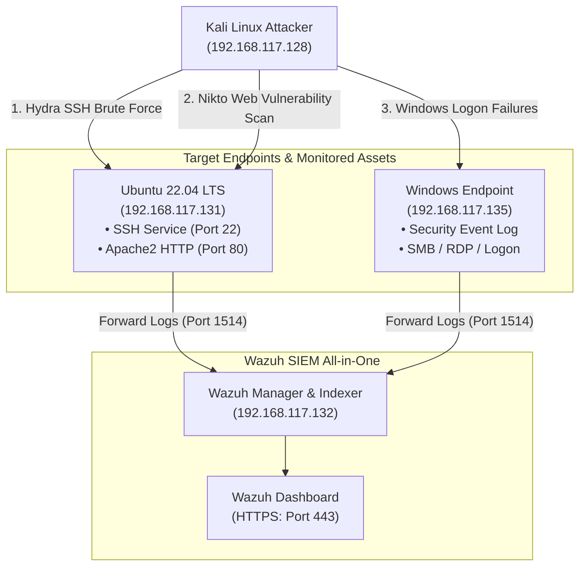

# Wazuh SIEM Detection Engineering & Threat Hunting Portfolio

A comprehensive hands-on Security Operations Center (SOC) detection lab series built with **Wazuh SIEM**. This portfolio demonstrates detection engineering, log analysis, and incident investigation across Linux, Windows, and Web application layers mapped to the **MITRE ATT&CK** framework.

> [!NOTE]
> **สถานะการพัฒนาโปรเจกต์ (Project Status):**
> - ✅ **01-ssh-brute-force**: **สมบูรณ์แล้ว (Completed)** พร้อมบทวิเคราะห์ ผลการทดสอบจริงด้วย Hydra รูปภาพหลักฐาน (Screenshots) และสคริปต์
> - ⏳ **02-windows-log-analysis**: **กำลังใส่เนื้อหา (In Progress / Work in Progress)** อยู่ระหว่างการจัดทำเนื้อหาและการทดสอบเพิ่มเติม
> - ⏳ **03-nikto-web-scan-detection**: **กำลังใส่เนื้อหา (In Progress / Work in Progress)** อยู่ระหว่างการจัดทำเนื้อหาและการทดสอบเพิ่มเติม

---

## 📚 Lab Series Overview



---

## 🗂️ Lab Modules

| Module | Lab Title | Status | Target OS / Service | Attack Tool | Key Rule / Event ID | MITRE ATT&CK Mapping |
| :---: | :--- | :---: | :--- | :--- | :--- | :--- |
| **01** | [SSH Brute Force Detection](01-ssh-brute-force/) | `Completed` (สมบูรณ์) | Ubuntu / SSH (Port 22) | Hydra | Rule `5763`, Rule `5760` | **T1110 / T1110.001**<br/>*(Credential Access: Brute Force)* |
| **02** | [Windows Security Log Analysis](02-windows-log-analysis/) | `In Progress` (กำลังใส่เนื้อหา) | Windows / Security Channel | Script / SMB | Event ID `4625`, Rule `60122`, Rule `60115` | **T1110.001**<br/>*(Credential Access: Password Guessing)* |
| **03** | [Nikto Web Vulnerability Scan Detection](03-nikto-web-scan-detection/) | `In Progress` (กำลังใส่เนื้อหา) | Ubuntu / Apache2 (Port 80) | Nikto | Rule `31101`, Rule `31106` | **T1595.002**<br/>*(Reconnaissance: Active Scanning)* |

---

## 🛠️ Environment Architecture

| Component | OS / Platform | IP Address | Role / Description |
| --- | --- | --- | --- |
| **Attacker** | Kali Linux | `192.168.117.128` | Simulates dictionary attacks, web scanning, and logon failures |
| **SIEM Server** | Ubuntu Server 22.04 LTS | `192.168.117.132` | Wazuh Manager, Indexer, and Dashboard (All-in-One) |
| **Linux Target** | Ubuntu Server 22.04 LTS | `192.168.117.131` | Wazuh Agent (`ubuntu_webserver2_agt`), hosting SSH & Apache2 |
| **Windows Target** | Windows 10/11 / Windows Server | `192.168.117.135` | Wazuh Agent (`windows_endpoint_agt`), monitored via Windows Event Logs |
| **Hypervisor** | VMware Workstation | Host Network | Host-only / NAT virtual networking |

---

## 🚀 Directory Structure

Each lab module is self-contained with its own reproduction scripts, detection queries, and evidence screenshots:

```text
Wazuh-SIEM-SSH-Brute-Force-Lab/
├── README.md                                  # Master Portfolio Index (This file)
├── LICENSE
├── 01-ssh-brute-force/                        # [Completed / สมบูรณ์] Module 1: Linux SSH Brute Force
│   ├── README.md
│   ├── images/                                # Evidence screenshots
│   ├── queries/                               # Threat hunting Lucene/KQL queries
│   └── scripts/                               # Attack simulation & setup scripts
├── 02-windows-log-analysis/                   # [In Progress / กำลังใส่เนื้อหา] Module 2: Windows Security Log Analysis
│   ├── README.md
│   ├── images/
│   ├── queries/
│   └── scripts/
└── 03-nikto-web-scan-detection/               # [In Progress / กำลังใส่เนื้อหา] Module 3: Nikto Web Vulnerability Scan
    ├── README.md
    ├── images/
    ├── queries/
    └── scripts/
```

---

## 🎯 Key Detection Highlights

1. **Linux Log Ingestion (`journald` / `auth.log`):**
   - Successfully correlated repeated `sshd` authentication failures from a single IP address into high-priority alert Rule `5763` (Level 10).
2. **Windows Event Log Ingestion (Event ID 4625):**
   - Ingested Windows Security channel logs to detect invalid credentials and aggregated multiple logon failures into Rule `60115` / `60204`.
3. **Web Application Access Logs (`access.log`):**
   - Real-time log monitoring of Apache access logs detecting active vulnerability scanners via User-Agent inspection (Rule `31101`) and HTTP 400 error frequency (Rule `31106`).

