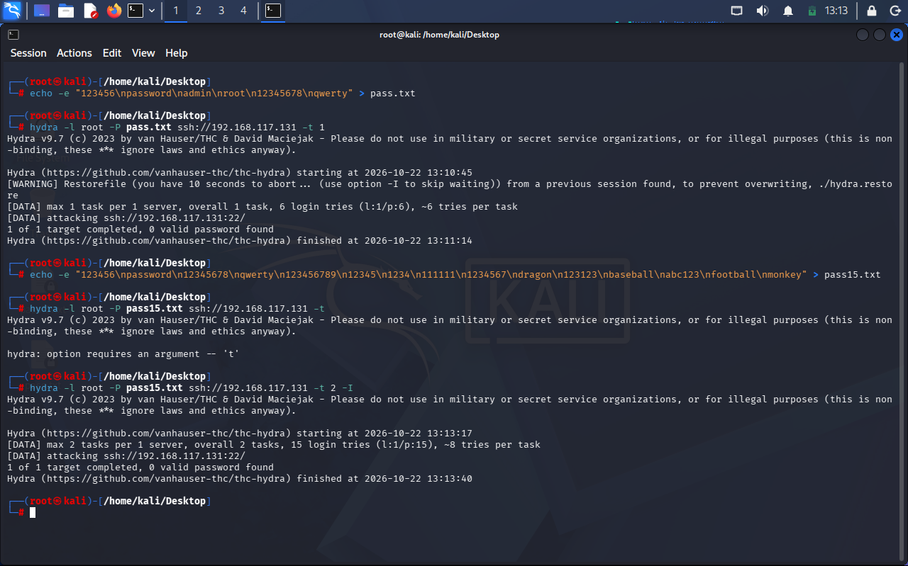
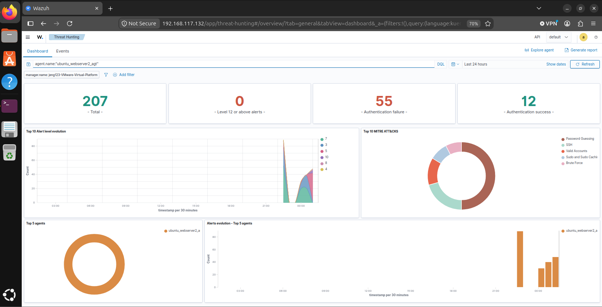
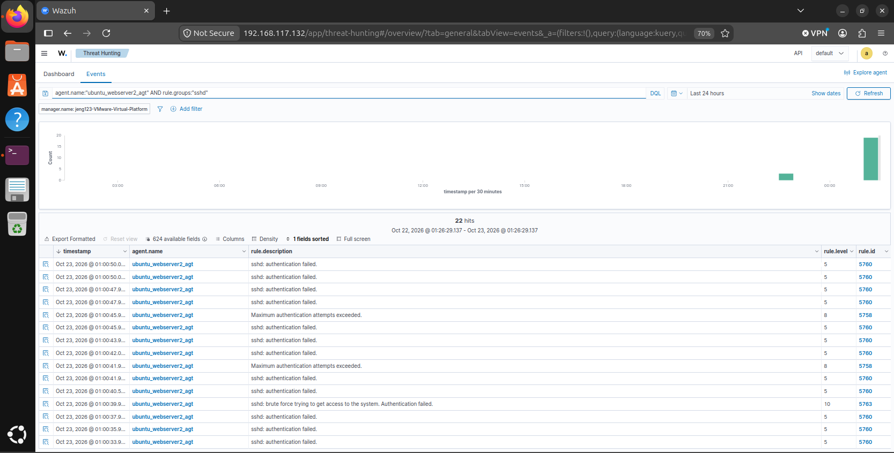
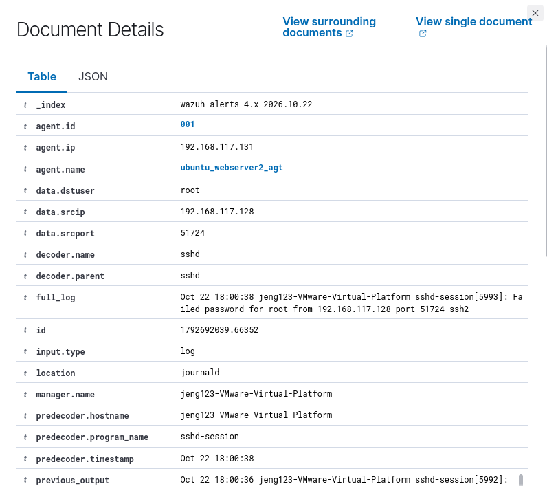
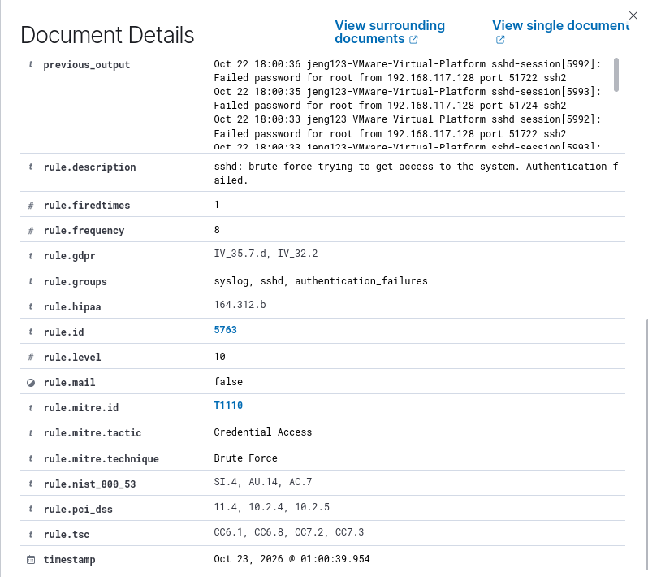

# Wazuh SIEM - SSH Brute Force Detection Lab

This academic/home lab uses Wazuh to detect repeated SSH password guesses against an Ubuntu endpoint. The latest evidence shows a Hydra dictionary attack and a Wazuh SSH brute-force alert. **Detection succeeded; Hydra reported `0 valid password found`.**

The screenshots from `New_Brute` are the primary evidence for this report. The course PDF and Word documents provided installation guidance for part of the setup. The course exercise used repeated manual SSH attempts with `nonexistent`; this lab uses Hydra to automate SSH attempts against `root`.

## Lab Environment

| Component | Configuration |
| --- | --- |
| Attacker | Kali Linux with Hydra v9.7 |
| Target endpoint | Ubuntu with Wazuh Agent, SSH at `192.168.117.131:22` |
| SIEM | Wazuh all-in-one on Ubuntu, dashboard at `https://192.168.117.132` |
| Agent | `ubuntu_webserver2_agt`, ID `001` |
| Source IP in the selected SSH alert | `192.168.117.128` |
| Target account | `root` |

The VMs run in VMware Workstation.

## Setup and Reproduction

The scripts are reproduction helpers. The installation helpers are not a record of the exact commands originally executed. Review their settings before using them on the appropriate VM.

### 1. Deploy the SIEM

The installation reference uses the Wazuh 4.14 all-in-one installer:

```bash
bash scripts/install_wazuh_server.sh
```

Save the dashboard credentials printed by the installer. If UFW is enabled, allow HTTPS access and verify its status:

```bash
sudo ufw allow 443/tcp
sudo ufw status
```

### 2. Deploy and Verify the Agent

On the Wazuh Dashboard, use **Deploy new agent**, select the Ubuntu package, set the manager to `192.168.117.132`, and set the agent name to `ubuntu_webserver2_agt`. Run the generated command on the target Ubuntu VM and follow its service-start instructions.

Alternatively, [install_wazuh_agent.sh](scripts/install_wazuh_agent.sh) installs a versioned package using `WAZUH_MANAGER` and `WAZUH_AGENT_NAME`. Its default package version is `4.14.0-1`, based on the installation reference; confirm the manager version and adjust `WAZUH_AGENT_VERSION` if needed before running it. It is intended for a fresh agent installation.

```bash
bash scripts/install_wazuh_agent.sh
sudo systemctl status wazuh-agent --no-pager
```

Verify that the agent appears as **Active** in the dashboard.

### 3. Enable SSH and Check Logs on the Target

```bash
sudo apt update
sudo apt install -y openssh-server
sudo systemctl enable --now ssh
sudo systemctl status ssh --no-pager
```

The latest alert records `location: journald` and the program `sshd-session`. Inspect SSH logs on the target with:

```bash
sudo journalctl -u ssh.service -n 30 --no-pager
```

On systems that also write authentication logs to a file, the course reference's check is:

```bash
sudo tail -n 30 /var/log/auth.log
```

### 4. Reproduce the Hydra Attempt on Kali

Install Hydra if it is missing (`sudo apt install -y hydra`). The final completed run in the latest terminal screenshot uses a 15-entry dictionary and this command:

```bash
hydra -l root -P pass15.txt ssh://192.168.117.131 -t 2 -I
```

[attack_simulation.sh](scripts/attack_simulation.sh) creates the same 15-entry dictionary and runs that command. `-t 2` uses two concurrent tasks; `-I` ignores an existing restore file. The screenshot also includes an earlier six-entry run and an incomplete `-t` command; the script reproduces the final completed 15-entry run.

```bash
bash scripts/attack_simulation.sh
```

### 5. Investigate the Wazuh Alerts

Open **Threat Hunting -> Events** and filter to the target agent and SSH rule group:

```text
agent.name:"ubuntu_webserver2_agt" AND rule.groups:"sshd"
```

To isolate the brute-force alert:

```text
agent.name:"ubuntu_webserver2_agt" AND rule.id:5763
```

Select a time range covering the test, account for VM/dashboard time zones, and inspect the matching document. More queries are in [wazuh_queries.md](queries/wazuh_queries.md).

## Results and MITRE ATT&CK Analysis

The latest Events screenshot contains Rule `5760` (`sshd: authentication failed`, Level `5`), Rule `5758` (`Maximum authentication attempts exceeded`, Level `8`), and Rule `5763` (SSH brute force, Level `10`).

The selected Rule `5763` document records failed SSH authentication for `root` from `192.168.117.128` to agent `192.168.117.131`, with these MITRE fields:

| Alert field | Observed value |
| --- | --- |
| `rule.mitre.id` | `T1110` |
| `rule.mitre.tactic` | `Credential Access` |
| `rule.mitre.technique` | `Brute Force` |

The dictionary attack can also be described as **T1110.001 - Password Guessing**, a sub-technique of Brute Force. The Wazuh 4.14 ruleset maps individual Rule `5760` failures to this sub-technique; it maps the correlated Rule `5763` alert to **T1110**. The table above reports the values actually displayed in the selected alert.

Hydra completed the final 15-entry run with **`0 valid password found`**. The evidence supports detection of repeated password guesses, without demonstrating successful access. Dashboard totals cover **Last 24 hours** and include other activity; its authentication-success count does not establish that Hydra logged in successfully.

## Latest Evidence

All five images below were copied without modification from the latest `New_Brute` folder.

### Hydra Terminal

Source: `Hydra_Bruteforze.png`. Shows the final 15-entry run and its unsuccessful password result.



### Threat Hunting Dashboard

Source: `Dashboard.png`. Shows the target-agent filter and the dashboard's 24-hour summary.



### SSH Events

Source: `Event_Log.png`. Shows the SSH-group filter and Rules `5760`, `5758`, and `5763`.



### Alert Details and Source Log

Source: `Doc_Detail1.png`. Shows agent identity, source IP, destination user, the failed-password log, and `journald` as the log source.



### Alert Rule and MITRE Fields

Source: `Doc_Detail2.png`. Shows Rule `5763`, Level `10`, and the observed **T1110 / Credential Access / Brute Force** mapping.



## References

- [Wazuh Linux agent installation](https://documentation.wazuh.com/current/installation-guide/wazuh-agent/wazuh-agent-package-linux.html)
- [Wazuh Linux deployment variables](https://documentation.wazuh.com/current/user-manual/agent/agent-enrollment/deployment-variables/deployment-variables-linux.html)
- [Wazuh 4.14 SSH rules](https://github.com/wazuh/wazuh/blob/v4.14.0/ruleset/rules/0095-sshd_rules.xml)
- [MITRE ATT&CK T1110 - Brute Force](https://attack.mitre.org/techniques/T1110/)
- [MITRE ATT&CK T1110.001 - Password Guessing](https://attack.mitre.org/techniques/T1110/001/)

## Scope

This project was conducted in an isolated virtual lab for educational purposes. Run the reproduction steps only against systems you own or are explicitly authorized to test.
